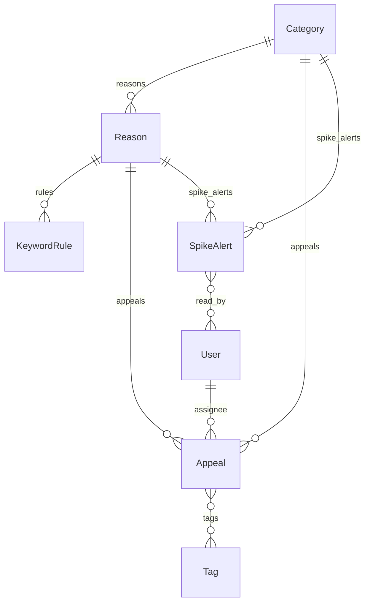

# Схема базы данных

База по умолчанию SQLite (файл `db.sqlite3`), схема создаётся миграциями Django и без изменений работает на PostgreSQL. Время хранится в UTC (`USE_TZ = True`), в интерфейсе и статистике переводится в Europe/Moscow.

Своих таблиц шесть: пять в приложении `appeals` и одна в `analytics`. Пользователи, группы и права берутся из стандартных таблиц `auth_*`, токены API хранятся в таблице `authtoken_token` приложения Django REST framework.

## appeals_category

Категория обращения, верхний уровень справочника. Около восьми записей: «Оплата», «Доставка», «Возвраты» и так далее.

| Поле | Тип | Смысл |
|---|---|---|
| id | bigint, PK | |
| name | varchar(100), unique | Название |
| slug | varchar(50), unique | Латинский код для адресов и API |
| description | text | Что относится к категории |
| color | varchar(7) | Цвет на графиках, `#RRGGBB` |
| sort | smallint | Порядок в списках и легендах |
| is_active | bool | Выключенная категория не предлагается в формах и не назначается автоматически, старые обращения её сохраняют |

## appeals_reason

Причина, второй уровень: конкретная проблема внутри категории, например «Двойное списание» в категории «Оплата». По причинам строятся топ (О7) и рейтинг проблем (Д7).

| Поле | Тип | Смысл |
|---|---|---|
| id | bigint, PK | |
| category_id | FK на category, PROTECT | Категория |
| name | varchar(150) | Название, уникально внутри категории (`reason_unique_in_category`) |
| is_active | bool | Как у категории |

## appeals_keywordrule

Ключевая фраза для автокатегоризации (Д1). Фраза хранится как её ввёл администратор, классификатор нормализует её сам при загрузке правил. Отдельного поля с нормализованной фразой нет, чтобы правка в админке не требовала синхронизации.

| Поле | Тип | Смысл |
|---|---|---|
| id | bigint, PK | |
| reason_id | FK на reason, CASCADE | Причина, на которую указывает фраза |
| phrase | varchar(200) | Слово или фраза, уникальна внутри причины (`rule_unique_in_reason`) |
| weight | smallint 1-3 | 1 слабый признак, 2 обычный, 3 сильный |

## appeals_tag и appeals_appeal_tags

Теги (Д3) не зависят от категории: «iOS», «Android», «повторное», «VIP». Связь с обращениями многие ко многим через таблицу `appeals_appeal_tags` (appeal_id, tag_id).

| Поле | Тип | Смысл |
|---|---|---|
| id | bigint, PK | |
| name | varchar(50), unique | Название |
| color | varchar(7) | Цвет метки |

## appeals_appeal

Обращение пользователя (О1).

| Поле | Тип | Смысл |
|---|---|---|
| id | bigint, PK | Номер обращения, по нему ищет запрос вида `#1234` |
| created_at | datetime | Когда поступило. Генератор демо-данных задаёт его явно |
| channel | varchar(10) | `app`, `web`, `email`, `phone`, `chat` |
| author_name, author_email | varchar | Автор. Аналитик видит их замаскированными (Д10) |
| subject | varchar(200) | Тема, может быть пустой: в чате и приложении её обычно нет |
| text | text | Текст обращения |
| text_norm | text | Основы слов через пробел. Заполняется при сохранении с шага 5, по нему работает текстовый поиск (Д2) |
| status | varchar(10) | `new` новое, `in_work` в работе, `resolved` решено, `closed` закрыто без решения (дубль, спам, клиент не ответил) |
| category_id | FK на category, null, PROTECT | Категория, пусто если не определена |
| reason_id | FK на reason, null, PROTECT | Причина |
| category_source | varchar(10) | `auto` классификатор, `manual` оператор, `none` не определена |
| category_score | float | Сумма весов фраз победившей категории |
| category_matches | json | Сработавшие фразы: `[{"reason": 12, "phrase": "...", "weight": 2}]`, показываются в карточке |
| assignee_id | FK на auth_user, null, SET_NULL | Исполнитель |
| resolved_at | datetime, null | Когда решено, по нему считается время решения |
| updated_at | datetime | Последнее изменение |

Ограничения на уровне базы:

- `appeal_reason_needs_category`: причина задаётся только вместе с категорией.
- `appeal_source_matches_category`: `auto` только при заполненной категории, `none` только при пустой. `manual` допустим в обоих случаях. Пустая ручная категория означает, что оператор решил оставить обращение без категории, и пересчёт по словарю её не тронет.

То, что причина относится именно к выбранной категории, проверяет `Appeal.clean()`. Это сравнение между таблицами, CHECK-ограничением его не выразить.

Индексы:

| Индекс | Поля | Для чего |
|---|---|---|
| appeal_created_idx | created_at | Список по дате, выборка за период |
| appeal_category_created_idx | category_id, created_at | Статистика и ряды по категориям за период |
| appeal_reason_created_idx | reason_id, created_at | Топ и рейтинг причин, всплески по причинам |
| appeal_status_idx | status | Фильтр по статусу, доля нерешённых |
| appeal_channel_idx | channel | Фильтр и разбивка по каналам |

## analytics_spikealert

Уведомление о резком росте (Д8). Запись описывает один день: либо по категории целиком (reason пустой), либо по одной причине.

| Поле | Тип | Смысл |
|---|---|---|
| id | bigint, PK | |
| category_id | FK на category, CASCADE | Категория |
| reason_id | FK на reason, null, CASCADE | Причина, пусто для уведомления по категории |
| day | date | День по московскому времени |
| count | int | Обращений за этот день |
| baseline | float | Обычный уровень: медиана за предыдущие 28 дней с поправкой на день недели |
| ratio | float | count / baseline. Если обычный уровень меньше одного обращения, count делится на 1 |
| created_at, updated_at | datetime | Когда найдено и когда обновлено число |
| read_by | M2M на auth_user | Кто уже прочитал, из этого считается счётчик непрочитанных |

На один день и одну цель существует одно уведомление. Обычный `unique (category, reason, day)` здесь не годится: NULL в reason не считается повтором, и уведомления по категории дублировались бы. Поэтому ограничений два, оба условные: `spike_unique_category_day` на (category, day) при пустом reason и `spike_unique_reason_day` на (category, reason, day) при заполненном. Индекс `spike_day_idx` нужен для страницы уведомлений, отсортированной по дню.

## Удаление записей

Категорию и причину, на которые ссылаются обращения, удалить нельзя (PROTECT), их выключают флагом `is_active`. Иначе статистика за прошлые периоды тихо потеряла бы данные. Ключевые фразы удаляются вместе с причиной. Уведомления удаляются вместе с категорией или причиной, потому что без них они бессмысленны. При удалении пользователя обращения остаются, исполнитель становится пустым.
